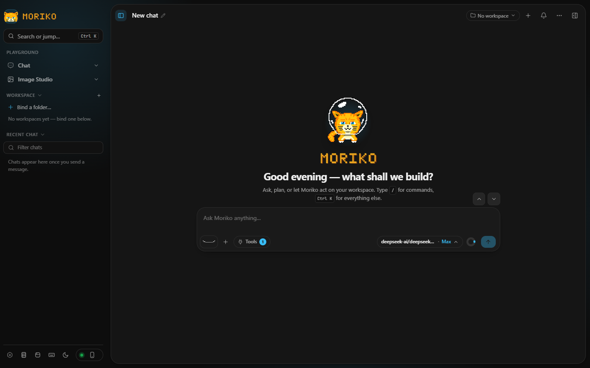
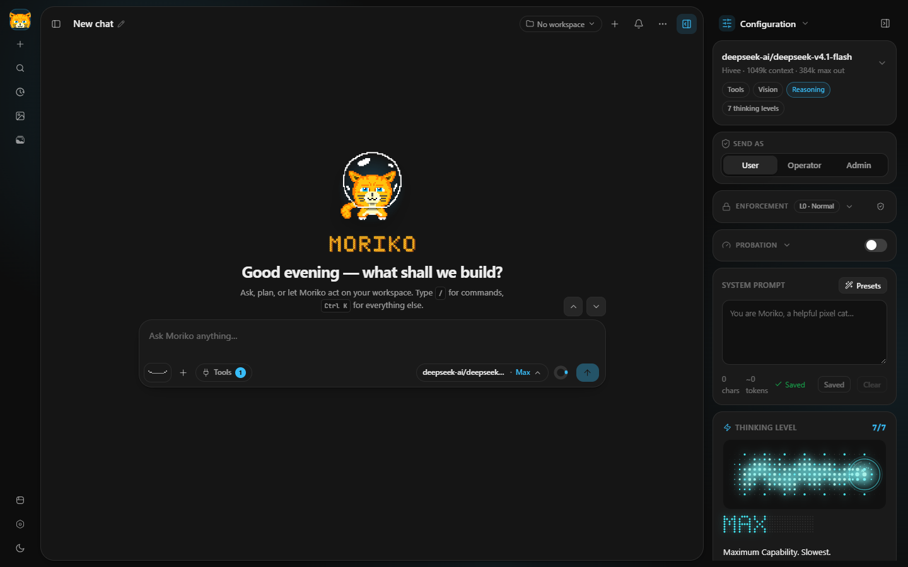
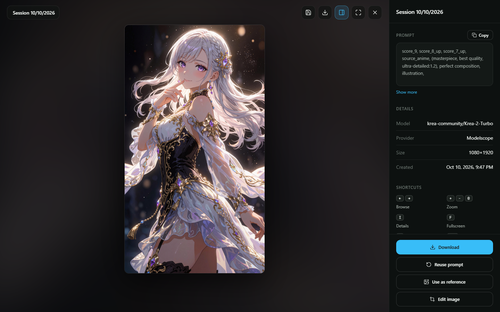
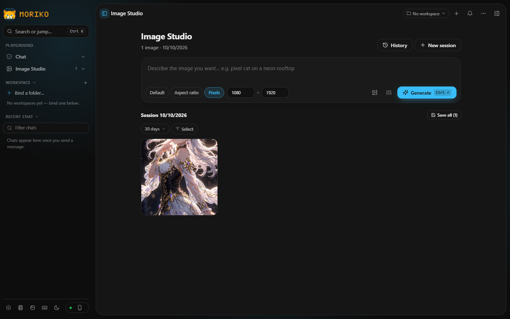
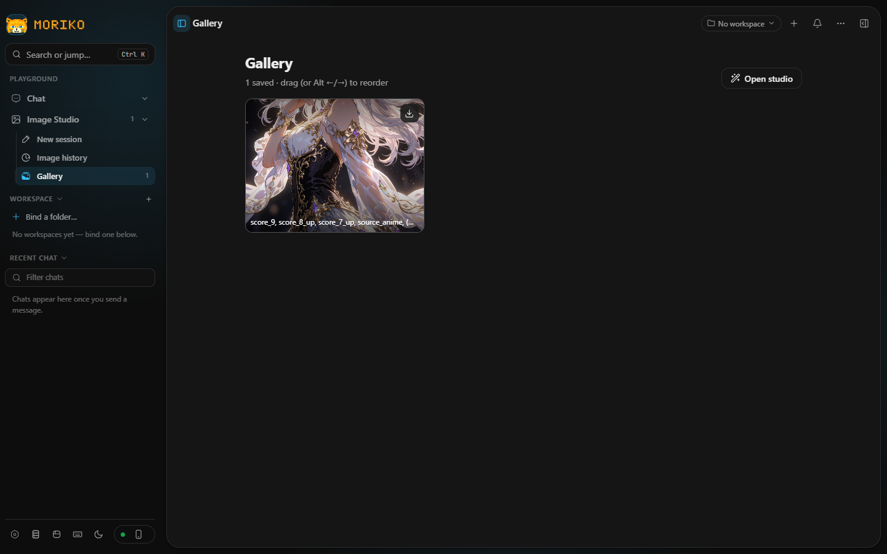

# Moriko Studio

## Preview

<p align="center">
  
</p>

<details>
  <summary><b>🔍 Lihat screenshot lainnya (Preview 2 - 5)</b></summary>
  <br>

  | Preview 2 | Preview 3 |
  | :---: | :---: |
  |  |  |

  | Preview 4 | Preview 5 |
  | :---: | :---: |
  |  |  |
</details>

---

## What's inside

| Area | What it does |
| --- | --- |
| **Playground** | Streaming multi-turn chat with markdown, GFM tables, KaTeX math, and copyable code blocks. |
| **System prompt** | Free-text system prompt with six presets, plus your own saved prompts. |
| **Thinking level** | Off / Low / Medium / High, mapped onto each provider's own reasoning control. |
| **Tools** | Structured outputs, code execution, function calling, URL context. |
| **Text size** | Small / Default / Large / Extra large, applied to the chat thread and composer. |
| **Image Studio** | Text-to-image testing against async generation APIs (ModelScope style). Pick any provider and model in Run settings — the panel adapts to the view. Optional output-size override: explicit pixels (sent as `size` + `width`/`height`) or an aspect-ratio preset (sent as `aspect_ratio`), forwarded untouched so you can see what each provider accepts. |
| **Gallery** | Persisted image collection: save Image Studio results one by one or all at once, reorder, and remove. |
| **Providers** | One built-in (OpenAI) plus unlimited custom providers (label, base URL, API format, models, key). |
| **History** | Threads saved in `localStorage`, grouped by day and searchable. |
| **Export / import** | One JSON bundle for conversations and browser-saved keys, validated on import. |
| **Themes** | Dark (default) and light, with AA-checked contrast in both. |

### System Prompt Harness :
- You can customize your harness system prompt injection by looking at file :
```
server/agents/systemPrompt.ts
```

- For harness tools catalogue, you can modify it in :
```
server/agents/tools/catalogue.ts
```

---

## Quick start

```bash
npm install
npm run dev
```

Open **http://localhost:5178** — no `.env` editing required. Configure your
providers (API keys, custom OpenAI-compatible endpoints, models) from the
**Providers** menu inside the app; keys are stored locally by the proxy.

The header printed by the proxy lists which providers are ready:

```
  Moriko Studio proxy → http://127.0.0.1:8791
  Providers ready:    OpenAI
  App data (~/.moriko-studio): C:/Users/you/.moriko-studio
```

---

## Architecture

Moriko Studio is two parts that always run together:

- **The app** — a React UI in your browser: chat, Image Studio, gallery,
  history, settings.
- **A small local server** — started for you by `npm run dev`. It holds your API
  keys, talks to the AI providers on your behalf, and saves your chats and
  images on disk under `~/.moriko-studio/`.

The browser never sees your keys and never contacts a provider directly. It only
ever talks to this local server; the server forwards each request to the right
provider — OpenAI, Gemini, Anthropic, or any OpenAI-compatible endpoint you add —
and streams the answer back to you live.

> **Why a local server at all?** Two reasons. Your API keys stay on your own
> machine instead of sitting inside browser JavaScript, and providers whose APIs
> refuse browser requests (CORS) or speak a non-OpenAI dialect still work.

### Layout

```
server/
  index.ts            Express app: routes, agent harness endpoints, SSE
  paths.ts            MORIKO_HOME resolution (default ~/.moriko-studio)
  contracts.ts        Wire types shared with the client (mirrored in src/types.ts)
  providers.ts        Built-in provider catalogue
  store.ts            JSON-file store for custom providers
  sse.ts              SSE frame parser + upstream error normalisation
  adapters/           openai.ts, gemini.ts, anthropic.ts (+ images/ for Image Studio)
  agents/             Agent mode: tools, spatial harness, permissions, vault
  mcp/                Model Context Protocol client + tool loop
  addons/             Addon system (loader, registry, bus, routes)
src/
  App.tsx             Shell (rail / workspace / run settings)
  store/useStore.ts   Zustand store; conversations + providers + UI state
  hooks/
    useChatController.ts  Request lifecycle: send, stop, regenerate
  lib/                api client, storage, brand assets, diff parsing, import/export
  components/         Sidebar, Thread, Composer, SettingsPanel, ProvidersDialog,
                      ImageStudio, GoalsPanel, CheckpointRail, Markdown, ui primitives
public/               Static assets served as-is (fonts, svg/ brand marks, favicon)
scripts/              Dev/build/sync tooling (dev.mjs, sync-*, setup-esbuild)
addons-src/           Source of the bundled visual-context addon
```

### Updating model support

The app keeps local snapshots of what each model can do — reasoning support,
image input, context window — plus a catalogue of community image
models, so the UI can offer the right controls for every model.

Refreshing is only about model support; nothing else depends on it:

```bash
pnpm sync
```

`pnpm dev` refreshes snapshots older than 24 hours on its own before starting,
and when you are offline it keeps the current snapshot and starts anyway.

---

## Adding a custom provider

Providers → **Add provider** → pick a template or fill in the fields.

| Field | Notes |
| --- | --- |
| **Display name** | Anything you like. |
| **API format** | `openai` for anything speaking `/chat/completions`; `gemini` and `anthropic` for their native APIs. |
| **Base URL** | Include the version segment: `https://api.example.com/v1`. |
| **API key** | Stored in the `~/.moriko-studio/api-keys.json` vault (with your provider's endpoint). Leave blank for local runtimes. |
| **Models** | Type ids manually or press **Fetch from provider**. |

Saved providers appear in the Run settings dropdown immediately. The
**API format** choice decides which adapter the proxy uses:

- **OpenAI-compatible**
- **Gemini**
- **Anthropic**

### How thinking level maps to each provider

| Level | OpenAI | Gemini | Anthropic |
| --- | --- | --- | --- |
| Off | param omitted | `thinkingBudget: 0` | thinking omitted |
| Low | `low` | 5% of max-out | 5% of max-out |
| Medium | `medium` | 15% of max-out | 15% of max-out |
| High | `high` | 30% of max-out | 30% of max-out |
| Xhigh | `xhigh` | 50% of max-out | 50% of max-out |
| Max | `max` | **64K** | **128K** |

Budgets scale with the model's own max-output (models.dev). **Max uses the
full allowance, capped at 64K (Gemini) / 128K (Anthropic)** — the Anthropic
adapter sends `budget + 1024` as `max_tokens`, so the budget keeps 1,024
tokens of headroom inside that 128K.

---

### Configuration
**You can change proxy port at :**
- vite.config.ts — Line  6: const proxyTarget = process.env.PROXY_TARGET ?? 'http://127.0.0.1:8826'
- server/index.ts — Line  123: const PORT = Number(process.env.PORT ?? 8826)

**For webdev port :**

- vite.config.ts — Line 15: port: 5588

---

### Where your data lives

One root, overridable with `MORIKO_HOME` (also from **Settings → Data**, persisted in
`.env` — takes effect on the next harness reload) — nothing is stored inside the
source tree:

```
~/.moriko-studi(or you custom location)/                 
├── providers.json                
├── api-keys.json                 
├── vision.json                   
├── mcp.json                      
├── agents.json                   
├── settings.json                 
├── reminders.json                
├── audit/ jobs/ read-state/ vault/   
├── conversation/
│   ├── index.json                
│   ├── manifest.json             
│   ├── chat-001-20260919/
│   │   ├── chat-data.json        
│   │   └── goals-plan.json       
│   └── detached/<session>.json   
├── image-session/
│   ├── data.json                 
│   ├── images/                   
│   ├── task-state.json · 
│   └── tasks.jsonl
└── gallery/
    └── data.json                 
```

On the first boot after restructuring, the proxy migrates the old flat stores
(in the repo's legacy `.data/`) into this layout automatically — originals are
renamed to `*.migrated`, never deleted.

---

## MCP (Use MCP)

Moriko speaks the [Model Context Protocol](https://modelcontextprotocol.io) —
register tool servers in **Settings → MCP servers** and turn on **Use MCP**
(Sidebar Configuration → Tools), so the model can call their tools mid-conversation.

Two transports:

- **Local command (stdio)** — the proxy spawns the server and speaks JSON-RPC
  over stdio. Example: the reference filesystem server

  ```
  name:    Filesystem
  command: npx
  args:    -y @modelcontextprotocol/server-filesystem C:/path/to/allow
  ```

- **Remote URL (Streamable HTTP)** — connect to a hosted MCP endpoint and send
  auth headers. Example: `https://mcp.deepwiki.com/mcp` with
  `Authorization: Bearer …` headers when required.


Notes:

- There is no fixed round limit: the loop keeps going while the model keeps
  making useful calls, with spin-guards that catch a model repeating itself. A
  single tool call times out after 90 s, and tool output is truncated before it
  re-enters the model context.
- Server configs live in `~/.moriko-studio/mcp.json` header/env secrets never leave
  the server (the settings UI only ever sees masked values).

---

## Agents (Agent mode)

Agent mode turns the current conversation into a working coding agent — no
separate view, chat agent stays in the same session. Flip it via the
**Chat | Agent** separator above the composer (empty state), the composer's
**Tools** menu, or Configuration → Tools.

Pick a **workspace** with the folder button: that folder becomes the agent's
playground. It gets dozens of tools — search and read code, edit and create
files, run builds and tests, drive git, browse web pages, even draw live
charts — and every action appears in the thread as a labelled card, so you
can watch the work happen instead of trusting a summary.

What keeps it safe:

- **It stays inside the workspace.** Paths are resolved against the workspace
  root and refused if they escape it; running commands and touching anything
  outside asks for your approval first (off / ask / auto for allow-listed
  programs).
- **Every change is undoable.** Each edit and delete snapshots the previous
  state into a local vault first, so a bad change is one step from restored.
- **Broken code never ships.** When the harness edits itself, the change is
  typechecked before it is applied; a failed check rejects it with the
  compiler output.

Workspaces are registered per machine in `~/.moriko-studio/agents.json`; the agent's
trail — audit log, snapshots, read state — lives beside the other data under
`~/.moriko-studio/`.

---

## Scripts

| Command | Description |
| --- | --- |
| `npm run dev` | Proxy + Vite dev server together. |
| `npm run dev:web` | Vite only |
| `npm run dev:server` | Proxy only, reloading on change. |
| `npm run build` | Typecheck, then build to `dist/`. |
| `npm start` | Serve the built app from the proxy (production). |
| `npm run typecheck` | Types only, no emit. |
| `pnpm sync` | Refresh the model-support snapshots. |

---

## Security notes

- **Keys never reach the browser** for built-in providers, the client sends a
  provider id, the server attaches the credential.
- **Imports are validated.** Every field of an imported bundle is coerced and
  clamped; malformed conversations are dropped rather than trusted.
- **The proxy binds to localhost.** It is a development tool — put real auth in
  front of it before exposing it to a network.

---

## Known limitations

- "Share this chat" copies a link containing the conversation id; that id is not
  resolvable by anyone else, since threads live in `localStorage`.
- Code execution and function calling are passed to the model as instructions,
  not executed locally.
- For Vault, the agent currently does not read the full code, so for now Vault will only restore files rather than the selected code areas.
