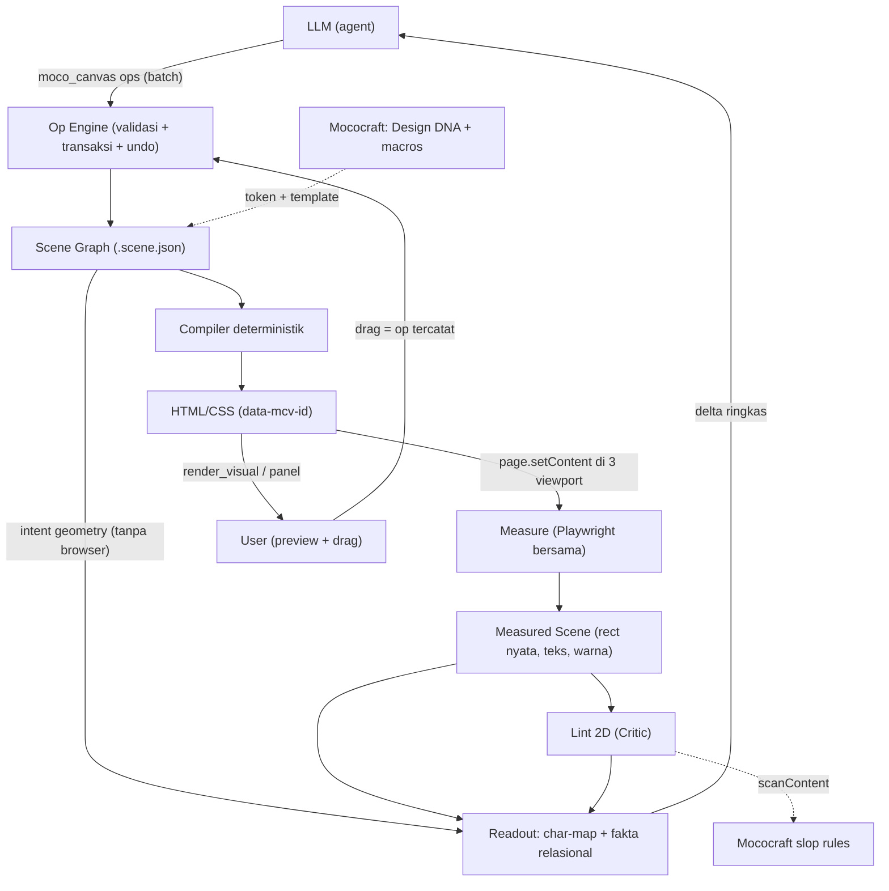

# Moco Canvas — Rancangan Engine Kanvas 2D untuk LLM

> Status: **P0–P4 TERIMPLEMENTASI** (P4 ditambah 2026-10-19: responsive override
> penuh, export Tailwind, import persepsi read-only, DAN op `constrain` §7.3 —
> relasi same-left/same-height/same-gap disimpan di scene + dicek tiap op;
> tanpa solver Cassowary, sesuai keputusan plan). Dibuat 2026-10-18.
> Pemilik: addon `moco-canvas` (rencana) + perluasan kecil di harness.
> Terkait: addon [`mococraft`](../addons-src/mococraft/addon.json), Spatial Harness
> (`server/agents/spatial*.ts`, `server/agents/tools/spatial.ts`, `layout-edit.ts`,
> `visual.ts`).

---

## 1. Ringkasan

LLM bekerja dalam **satu dimensi**: deretan token. Sementara itu, desain web
adalah persoalan **dua dimensi**: posisi, jarak, kesejajaran, keseimbangan.
Saat LLM menulis CSS, ia "membayangkan" tata letak tanpa pernah melihat hasilnya,
seperti mendesain sambil menutup mata.

Desainer yang memakai Canva bekerja dalam loop yang berbeda:

1. **Melihat** kanvas,
2. **Memegang** objek (pilih, geser, ubah ukuran),
3. **Dibantu** garis snap/align dan grid,
4. **Melihat lagi** hasilnya seketika.

**Moco Canvas** adalah engine yang memberi LLM loop yang sama, tetapi
seluruhnya dalam bentuk teks:

| Loop Canva (manusia) | Padanan Moco Canvas (LLM) |
|---|---|
| Kanvas dengan objek | **Scene Graph**: dokumen 2D terstruktur, sumber kebenaran |
| Drag, resize, align | **Operasi kanvas**: `place`, `move`, `align`, `distribute`, `stack`… |
| Grid & snap | **Alamat grid diskret** ala spreadsheet (`B2:H5`) + skala spacing |
| Mata | **Readout spasial**: peta karakter ASCII + fakta relasional + (opsional) screenshot |
| Insting desainer | **Lint 2D**: overlap, alignment drift, ritme spacing, balance, kontras |
| Tombol "Download" | **Compiler deterministik**: scene → HTML/CSS (grid/flex) yang bersih |

Prinsip intinya mengikuti filosofi Spatial Harness yang sudah ada:

> **LLM bekerja di *intent space*; engine mengukur di *metric space*.**
> LLM tidak pernah menebak piksel. LLM menyatakan maksud, engine menghitung angka,
> lalu engine melaporkan balik apa yang sebenarnya terjadi.

---

## 2. Masalah: kenapa LLM "buta ruang"

1. **Serialisasi merusak geometri.** CSS `grid-template-columns: 7fr 5fr` dan
   elemen yang ditempatkan 400 baris kemudian di JSX saling berhubungan secara
   spasial, tetapi berjauhan di stream token. Model harus merekonstruksi tata
   letak di "kepalanya".
2. **Tidak ada umpan balik.** Model menulis, lalu langsung menganggap selesai.
   Overlap, overflow, teks terpotong, dan jarak yang tidak konsisten baru
   terlihat oleh user.
3. **Piksel ajaib.** Tanpa sistem koordinat yang berarti, model menebak
   `top: 137px`. Static IR kita sudah mencatat masalah ini sebagai `magicNumbers` (P1).
4. **Default attractor.** Tanpa kanvas untuk "dilihat", model kembali ke template
   aman: hero di tengah, grid 3 kolom, bento simetris. Inilah *slop* yang dilawan
   Mococraft.
5. **ASCII art saja tidak cukup.** LLM lemah dalam membaca kesejajaran
   **vertikal** pada teks monospace (kolom ke-37 di baris 4 vs baris 9). Karena itu
   "mata" untuk LLM harus berlapis, bukan cuma gambar ASCII (lihat §6).

---

## 3. Yang sudah ada di harness (fondasi, JANGAN diduplikasi)

| Komponen | Lokasi | Kemampuan | Batasan yang relevan |
|---|---|---|---|
| Static Spatial IR | `server/agents/spatial.ts` | Ekstrak box `absolute/fixed` dari CSS & JSX inline, deteksi collision, diff | Hanya box absolut dengan `top/left/width/height` px lengkap. Flow/flex/grid tidak terjangkau |
| `agent__spatial` | `server/agents/tools/spatial.ts` | Mode `map`, `check`, `diff`, `runtime`, `mockup` | Readout berupa daftar region, belum ada gambaran 2D atau lint estetika |
| `agent__layout_edit` | `server/agents/tools/layout-edit.ts` | Edit berbasis intent (`move-right-of`, `move-below`, `swap`, `resize-relative`, `align`), angka dihitung compiler | **Hanya untuk box absolut px di file yang sama.** UI modern (flex/grid) tidak tersentuh |
| Runtime tier | `server/agents/spatial-runtime.ts` | Playwright (msedge → chromium), browser bersama dengan TTL 60 dtk, `getBoundingClientRect`, collision "hard", screenshot | Butuh **URL** dev server. Ekstraksi **membuang** wrapper anonim in-flow (teks/gambar biasa sering terlewat) |
| Mockup tier | `server/agents/spatial-mockup.ts` | Gambar mockup → region via vision model | Hanya target desain, bukan editor |
| `agent__render_visual` | `server/agents/tools/visual.ts` | HTML standalone di iframe sandbox (CSP `default-src 'none'`), edit-in-place lewat `id`, 1..3 varian + pick user | Hanya untuk ditampilkan ke user, tanpa pengukuran |
| Mococraft | `addons-src/mococraft/` | Design DNA (OKLCH), macrostructures, slop gate regex | Murni 1D (regex atas teks) |

> [!NOTE]
> Komentar kode merujuk `docs/plans/PLAN-SPATIAL-HARNESS.md`, tetapi file itu
> **tidak ada** di `docs/`. Bila masih tersimpan di tempat lain, sebaiknya
> dipulihkan agar rencana ini bisa dikaitkan dengan fase F0–F4.

**Kesimpulan:** Spatial Harness adalah **mata dan penggaris** (mengukur). Yang
belum ada adalah **kanvas dan tangan**: model dokumen 2D yang bisa dimanipulasi,
dengan sistem koordinat bermakna untuk layout flow/grid, ditambah readout yang
benar-benar memberi LLM gambaran 2D.

---

## 4. Arsitektur



### 4.1 Lapisan

1. **Scene Graph**: dokumen JSON, satu-satunya sumber kebenaran desain.
2. **Op Engine**: menerima operasi kanvas, memvalidasi, menerapkan secara
   atomik (per batch), dan mencatat log operasi untuk undo/redo dan audit.
3. **Geometry Resolver (intent)**: menghitung rect dari alamat grid dan aturan
   stack **tanpa browser**. Hasilnya cepat dan deterministik, cukup untuk readout tahap awal.
4. **Compiler**: scene → HTML + CSS yang bisa dibaca manusia, dengan atribut
   `data-mcv-id` untuk pemetaan balik DOM → node.
5. **Measurer**: merender hasil compile di browser headless (memakai ulang
   `getReusableBrowser`) lewat `page.setContent`, **tanpa butuh dev server**.
6. **Critic (Lint 2D)**: aturan geometri dan estetika di atas Measured Scene.
7. **Readout Renderer**: mengubah semuanya menjadi teks ringkas untuk LLM.
8. **Panel (UI user)**: preview live + overlay box, dan user bisa ikut menggeser.

---

## 5. Scene Graph (model dokumen)

### 5.1 Jenis node

| Kind | Fungsi | Padanan Canva/Figma |
|---|---|---|
| `page` | Root dengan breakpoint dan token | Halaman/artboard |
| `frame` | Kontainer dengan `layout` | Frame / auto-layout |
| `text` | Teks dengan `role` tipografi | Text box |
| `image` | Gambar/placeholder dengan `fit` dan `ratio` | Image frame |
| `shape` | Blok warna, garis, divider | Elemen dasar |
| `slot` | Placeholder komponen (mis. "form login") yang akan diisi kode | Grup terkunci |
| `ref` | Instance dari template (macrostructure Mococraft) | Component instance |

### 5.2 Mode layout untuk `frame`

| Mode | Kapan dipakai | Compile ke |
|---|---|---|
| `grid` | Tata letak halaman/section, asimetri | CSS Grid + `grid-template-areas` bernama |
| `stack` | Daftar, toolbar, tumpukan teks | Flexbox (`dir`, `gap`, `align`, `justify`, `wrap`) |
| `free` | Overlay dekoratif, *escape hatch* | `position: absolute` relatif ke frame |

> [!IMPORTANT]
> `free` sengaja **dibuat mahal**: setiap pemakaian memunculkan peringatan di
> readout. Engine ini ada untuk mengarahkan LLM ke flow/grid. Itu kebalikan dari
> `layout_edit` saat ini, yang hanya bisa bekerja pada box absolut.

### 5.3 Sistem koordinat: alamat grid ala spreadsheet

LLM sangat nyaman dengan notasi spreadsheet karena notasi itu muncul di banyak data latih.
Setiap frame `grid` memiliki kolom berlabel huruf (`A`…`L` untuk 12 kolom) dan
baris bernomor:

```
at: "B2:H5"   → kolom B s.d. H, baris 2 s.d. 5
at: "A1"      → satu sel
at: "A3:L3"   → satu baris penuh (full-bleed dalam frame)
```

- Kolom: lebar `fr` (default `repeat(12, 1fr)`) atau daftar eksplisit `["7fr","5fr"]`.
- Baris: `auto` (mengikuti konten) secara default, bisa diganti ke `rowUnit` tetap (mis. 8px)
  untuk desain yang ketat.
- **Tidak ada piksel di dalam op.** Ukuran memakai token spacing (`$s1`…`$s12`) atau
  `fr`/`ch`/rasio. Piksel hanya muncul di **readout** (hasil ukur), tidak pernah di input.

### 5.4 Token

Scene mereferensikan token, tidak memakai nilai mentah:

- Warna: `$canvas`, `$ink`, `$accent`, `$hairline`, `$muted`, diambil dari
  **Design DNA** Mococraft yang sedang dikunci (OKLCH).
- Tipografi: `role: display | heading | body | caption | mono`, dipetakan ke
  `displayFont` / `bodyFont` dari DNA, dengan skala tipe (mis. rasio 1.25).
- Spacing: skala 4/8 (`$s1=4px … $s12=96px`), yang memungkinkan lint ritme.

### 5.5 Contoh dokumen

```json
{
  "version": 1,
  "id": "landing",
  "dna": "editorial",
  "breakpoints": { "sm": 390, "md": 768, "lg": 1440 },
  "root": {
    "id": "page", "kind": "page",
    "children": [
      {
        "id": "hero", "kind": "frame",
        "layout": { "mode": "grid", "cols": ["7fr", "5fr"], "rows": "auto", "gap": "$s8", "pad": "$s10" },
        "children": [
          { "id": "hero.copy", "kind": "frame", "at": "A1",
            "layout": { "mode": "stack", "dir": "col", "gap": "$s5", "align": "start" },
            "children": [
              { "id": "hero.title", "kind": "text", "role": "display", "text": "Arsip suara kota" },
              { "id": "hero.lead", "kind": "text", "role": "body", "maxWidth": "52ch",
                "text": "Rekaman lapangan dari 40 pasar tradisional, dikurasi per jam." },
              { "id": "hero.cta", "kind": "frame", "layout": { "mode": "stack", "dir": "row", "gap": "$s3" } }
            ]
          },
          { "id": "hero.img", "kind": "image", "at": "B1", "ratio": "4/5", "fit": "cover" }
        ],
        "responsive": { "sm": { "layout": { "cols": ["1fr"] }, "hero.img": { "at": "A2" } } }
      }
    ]
  }
}
```

### 5.6 Penyimpanan

- Dokumen: `<workspace>/.moriko/moco-canvas/<doc>.scene.json`
- Log operasi: `<workspace>/.moriko/moco-canvas/<doc>.ops.jsonl` (append-only, sumber undo/redo)
- Hasil ukur & screenshot: `<workspace>/.moriko/moco-canvas/measure/`

Semua tersimpan sebagai file di komputer user, sesuai aturan privasi AGENTS.md
(tidak ada `localStorage`/IndexedDB). Izin manifest: `workspace.write:.moriko/moco-canvas/**`.

---

## 6. "Mata" untuk LLM 1D: readout berlapis

Satu representasi tidak cukup. Readout disusun dalam **tiga lapis**, dari yang
paling murah hingga yang paling kaya. LLM mendapat lapis 1 dan 2 secara default.

### Lapis 1: Char-map (gambaran 2D dalam token)

Setiap sel grid = satu karakter, dan setiap node = satu huruf legenda. Cara ini
hemat token dan bentuk globalnya langsung terbaca:

```
SCENE landing @lg 1440×1180 · hero grid 12×6 · 6 nodes · 0 overlap · 2 lint

      A B C D E F G H I J K L
   1  n n n n n n n n n n n n
   2  t t t t t t t . i i i i
   3  t t t t t t t . i i i i
   4  l l l l l . . . i i i i
   5  c c . . . . . . i i i i
   6  . . . . . . . . . . . .

legend  n=nav  t=hero.title  l=hero.lead  c=hero.cta  i=hero.img
marks   . kosong   # overlap   ! overflow   ~ terpotong
```

- Char-map dirender **per frame** yang sedang difokuskan (zoom), bukan seluruh halaman sekaligus,
  supaya ukurannya tetap kecil (≤ 24 kolom × 20 baris).
- Untuk frame `stack`, isinya dirender sebagai urutan linear dengan ukuran relatif, bukan grid.

### Lapis 2: Fakta relasional (kalimat 1D yang mengodekan 2D)

Bagian ini menutup kelemahan LLM membaca kolom vertikal. Relasi spasial
disampaikan sebagai **kalimat eksplisit**:

```
ALIGN   hero.title.left = hero.lead.left = hero.cta.left (x=160)      ✓
ALIGN   hero.img.top 4px di bawah hero.title.top                       ~ drift (snap ke 0?)
GAP     hero.lead → hero.cta 28px                                      ~ di luar skala ($s6=24 | $s8=32)
FLOW    hero.copy (A) | hero.img (B), rasio lebar 58/42
BALANCE berat visual kiri 61% / kanan 39%                              ✓ asimetri sehat
TEXT    hero.lead 3 baris, 58 ch/baris                                 ✓ (45–75)
VIEW    @sm: hero.img turun ke bawah hero.copy, tanpa scroll horizontal ✓
```

### Lapis 3: Visual (opsional, untuk model multimodal)

- Screenshot hasil ukur dengan **overlay**: kotak tiap node plus label id-nya,
  sehingga model vision bisa mengaitkan piksel dengan id node.
- Bila model utama bukan multimodal, gunakan **vision model yang dikonfigurasi**
  (`getVisionConfig` + `callVisionModel`, jalur yang sudah dipakai mode `mockup`) untuk
  memberi kritik singkat berbasis rubrik, lalu kembalikan hasilnya sebagai teks.

### Aturan anggaran token

- Setiap op mengembalikan **delta** saja: node yang berubah, fakta yang berubah,
  lint baru/terselesaikan. Readout penuh hanya dikirim lewat `inspect`.
- Batas default readout: ±1.500 karakter, dan bisa di-zoom ke node tertentu.
- Readout selalu menyebut **id node** yang bisa langsung dipakai di op berikutnya,
  supaya tidak ada id hasil halusinasi (pola yang sama dengan `render_visual` edit-in-place).

---

## 7. Operasi kanvas ("tangan")

### 7.1 Bentuk tool

Satu tool agen, `moco_canvas`, dengan field `op` atau batch `ops[]`. Satu tool
dipilih agar katalog tool tetap ramping:

```json
{
  "doc": "landing",
  "ops": [
    { "op": "place", "id": "hero.badge", "kind": "text", "in": "hero.copy", "before": "hero.title",
      "role": "caption", "text": "Edisi 03" },
    { "op": "align", "ids": ["hero.img"], "edge": "top", "to": "hero.title" },
    { "op": "space", "between": ["hero.lead", "hero.cta"], "gap": "$s8" }
  ],
  "measure": true
}
```

- Satu batch = **satu transaksi**: semua op berhasil atau semua dibatalkan.
- `dryRun: true` → mengembalikan prediksi readout tanpa menyimpan.
- Hasil: delta readout + lint + `rev` (nomor revisi, untuk undo).

### 7.2 Katalog op

| Op | Fungsi | Analogi Canva |
|---|---|---|
| `new` | Buat dokumen (opsional dari template/macro) | Buat desain baru |
| `inspect` | Readout penuh / zoom ke node | Melihat kanvas |
| `place` | Tambah node: `in` + `at` (grid) atau `before/after` (stack) | Drag elemen dari panel |
| `move` | Pindah sel grid / urutan stack / parent | Drag |
| `resize` | Ubah span (`at`), `maxWidth`, `ratio` | Tarik handle |
| `align` | Sejajarkan edge/center ke node lain atau ke frame | Tombol Align |
| `distribute` | Ratakan jarak sejumlah node | Distribute spacing |
| `space` | Atur gap antar node dengan token | Smart spacing |
| `stack` / `grid` | Ubah mode layout frame | Auto-layout on/off |
| `group` / `ungroup` | Bungkus beberapa node dalam frame | Group |
| `style` | Token warna, role tipografi, radius, border | Panel properti |
| `text` | Ubah isi teks | Klik dan ketik |
| `swap` | Tukar posisi dua node | — |
| `delete` | Hapus node | Delete |
| `responsive` | Override per breakpoint | Resize desain |
| `undo` / `redo` / `rev` | Mundur atau maju lewat log op | Ctrl+Z |
| `export` | Compile ke file target | Download |

### 7.3 Constraint (relasi, bukan angka)

Beberapa op bisa ditulis sebagai relasi yang **dijaga terus**, bukan perintah
sekali jalan:

```json
{ "op": "constrain", "rule": "same-left", "ids": ["hero.title", "hero.lead", "hero.cta"] }
{ "op": "constrain", "rule": "same-height", "ids": ["plan.a", "plan.b", "plan.c"] }
```

Constraint disimpan di scene. Compiler memenuhinya lewat struktur, misalnya
dengan menaruh node-node itu dalam satu kolom grid yang sama. Bila sebuah op
melanggar constraint, op tersebut ditolak dengan penjelasan. Solver penuh ala
Cassowary **belum diperlukan** di fase awal, karena sebagian besar relasi
desain web bisa diturunkan dari struktur grid/stack.

### 7.4 Pesan error yang mengajari

Mengikuti pola `layout_edit` dan `render_visual`, setiap kesalahan mengembalikan
pilihan yang valid:

```
place gagal: sel "M2" di luar grid hero (12 kolom A–L).
Sel kosong terdekat: H2, H3, A6:L6. Atau perluas grid: {op:"grid", id:"hero", cols:13}.
```

---

## 8. Compiler (scene → kode)

### 8.1 Aturan output

- **Dapat dibaca manusia dan bisa di-*eject*.** Output harus terlihat seperti
  kode yang ditulis desainer-developer yang rapi, bukan dump mesin. User boleh
  berhenti memakai kanvas kapan saja.
- `grid` → CSS Grid dengan `grid-template-areas` bernama dari id node
  (`"copy img"`), bukan `grid-column: 1 / 8` yang samar.
- `stack` → flexbox dengan `gap`.
- Token → custom property (`--mcv-accent`), yang nilainya diisi dari DNA.
- Responsive → media query dari `breakpoints`, mobile-first.
- Setiap elemen membawa `data-mcv-id="hero.title"` untuk pemetaan balik (bisa
  dibuang dengan `export { strip: true }`).

### 8.2 Target

| Target | Fase | Catatan |
|---|---|---|
| HTML + CSS standalone | P0 | Untuk preview, pengukuran, dan `render_visual` |
| React + CSS file | P3 | Komponen per frame tingkat atas |
| Tailwind | P4 | Opsional, hanya bila proyek user memakai Tailwind |

> Align dengan revisi fase: compile HTML/CSS memang jalan di P0 karena ia
> fungsi murni yang menyajikan preview panel; export **file** ke workspace
> tetap P3.

### 8.3 Region terkelola

Saat diekspor ke file proyek, kode ditaruh di antara penanda:

```tsx
{/* mcv:begin landing/hero rev=14 */}
…
{/* mcv:end landing/hero */}
```

Engine hanya menimpa isi di antara penanda. Bila user atau agen mengedit isi
region secara manual, `export` mendeteksi hash yang berbeda dan **menolak menimpa**,
lalu menawarkan dua pilihan: `import` (baca balik) atau `force`.

---

## 9. Measurer (pengukuran nyata)

- Memakai ulang `getReusableBrowser()` dari `spatial-runtime.ts`, jadi tidak ada
  peluncuran browser kedua dan tidak ada dependency baru.
- `page.setContent(html)` menggantikan `page.goto(url)`, sehingga **tidak perlu
  dev server**. HTML hasil compile sudah lengkap dan tanpa jaringan (font
  di-fallback ke font lokal, lalu dicatat di readout bila fallback terjadi).
- Ukur di **3 viewport** sekaligus (`sm` 390, `md` 768, `lg` 1440) dalam satu sesi
  browser.
- Ekstraksi **semua** `[data-mcv-id]`, bukan hanya elemen bernama atau interaktif seperti
  `EXTRACT_SCRIPT` saat ini, ditambah:
  - rect, `scrollWidth > clientWidth` (overflow), jumlah baris teks (`Range.getClientRects`),
  - computed `color` / `background-color` untuk menghitung kontras,
  - `font-family` yang benar-benar dipakai (mendeteksi fallback).
- Fallback tanpa Playwright: readout tetap jalan dengan **intent geometry**
  (§4.1 butir 3) dan diberi label `tier: intent` secara jujur, seperti label
  `static` vs `runtime` pada Spatial IR.

---

## 10. Critic: Lint 2D

| Rule | Dimensi | Severity | Cara ukur |
|---|---|---|---|
| `overlap` | Layout | critical | Interseksi rect antar node non-overlay (pakai `intersectionRect`) |
| `overflow` | Layout | critical | `scrollWidth > clientWidth`, teks keluar frame |
| `h-scroll-mobile` | Responsive | critical | Lebar dokumen > viewport pada `sm` |
| `align-drift` | Alignment | warn | Dua edge berselisih 1–6px (hampir sejajar = tampak tidak sengaja) |
| `off-scale-gap` | Ritme | warn | Gap terukur tidak jatuh di skala spacing |
| `line-length` | Tipografi | warn | ch per baris di luar 45–75 untuk `body` |
| `hierarchy-flat` | Tipografi | warn | Rasio ukuran display/body < 1.6 |
| `contrast` | Warna | critical | WCAG AA (4.5:1 body, 3:1 teks besar) dari warna terhitung |
| `tap-target` | Interaksi | warn | Elemen interaktif < 44×44 pada `sm` |
| `symmetry-default` | Anti-slop | warn | Grid 3 kolom dengan lebar sama atau hero terpusat penuh (terhubung ke Mococraft) |
| `balance` | Komposisi | info | Centroid berbobot luas; dilaporkan, bukan dihakimi |
| `free-abuse` | Struktur | warn | Node `free` di luar konteks dekoratif/overlay |
| `dead-space` | Komposisi | info | Area kosong besar yang tidak diniatkan (`.` beruntun di char-map) |

Lint estetika berstatus **info/warn**, bukan pemblokir. Yang boleh memblokir
`export` hanyalah fakta terukur: overlap, overflow, h-scroll, kontras.

---

## 11. Integrasi dengan Mococraft

| Mococraft | Peran di Moco Canvas | Mekanisme |
|---|---|---|
| Design DNA terkunci | Token warna & font scene | Mococraft mengekspos `api.api.expose('mococraft', { activeDna, dnaById })`, lalu Moco Canvas memakai `api.api.use('mococraft')` |
| `MACROSTRUCTURES` | Template scene (`new { from: "split-diptych" }`) | Setiap macro diberi padanan sketsa scene JSON (bukan hanya string CSS) |
| Slop rules (`scanContent`) | Dijalankan pada output compile sebelum `export` | Lewat mod API yang sama |
| Slop gate (`tool.call`) | Tidak berlaku untuk file yang ditulis addon | Karena itu pengecekan di butir sebelumnya wajib |

Moco Canvas tetap **bisa berjalan tanpa Mococraft**. Dalam kondisi itu ia memakai
token netral default dan menulis catatan di readout.

---

## 12. Kolaborasi manusia ↔ LLM (sisi "Canva" untuk user)

Log operasi adalah **bahasa bersama** antara user dan agen.

- Panel menampilkan preview live (iframe sandbox, pola `render_visual`) dengan
  overlay box dan id node.
- User bisa **menggeser, mengubah ukuran, dan menyejajarkan** langsung di panel. Setiap
  gerakan diterjemahkan menjadi op yang sama persis dengan milik agen, lalu dicatat di `.ops.jsonl`.
- Agen menerima perubahan user sebagai delta saat giliran berikutnya, mis.
  `USER moved hero.cta A5 → A4; resized hero.img B1 span 1→2 rows`.
- User dapat **mengunci** node (`lock`) agar tidak diubah agen.

Hasilnya seperti dua orang mengedit satu desain Canva yang sama, dan masing-masing
melihat apa yang dilakukan pihak lain.

### Aturan UI panel (sesuai AGENTS.md)

- CSS panel ditulis di file milik addon (`addons-src/moco-canvas/client/panel.css`)
  dengan prefix `.mcv`, **tidak boleh** ditulis ke `index.css`/`addon.css`
  milik harness atau addon lain.
- Token warna panel (`--mcv-*`) didefinisikan untuk **tiga theme** dengan selector
  terskop (`.mcv`, `.dark .mcv`, `.mocha .mcv`). Elemen kecil seperti handle, garis
  snap, dan label overlay wajib terbaca di light mode.
- **Dilarang** memakai atribut `title` native. Ikon tanpa label memakai `<Tip>`, dan
  hanya bila memang tidak self-evident.
- Notifikasi memakai `notify` / komponen tema Moriko, bukan `alert` browser.

---

## 13. Contoh sesi end-to-end

**User:** "Buat hero untuk arsip suara kota, gaya editorial."

1. Agen → `moco_canvas { op: "new", doc: "landing", from: "split-diptych" }`
   → readout: char-map grid 7fr/5fr kosong, DNA `editorial` terdeteksi.
2. Agen → batch `place` judul, lead, CTA di A1 (stack), gambar di B1.
   → readout delta + lint: `off-scale-gap lead→cta 28px`, `align-drift img.top +4px`.
3. Agen → batch `space $s8` dan `align img top → title`.
   → `0 lint critical, 0 warn`. Fakta: `BALANCE 61/39 ✓`, `@sm stack vertikal ✓`.
4. User menggeser CTA lebih dekat ke lead di panel.
   → agen menerima `USER moved…`, lalu menghormati perubahan itu.
5. Agen → `export { target: "src/pages/Landing.tsx", region: "hero" }`
   → slop scan Mococraft bersih → file ditulis di antara penanda `mcv:begin/end`.

Agen tidak pernah menulis satu angka piksel pun, tetapi setiap angka yang
dihasilkan tercatat dan terukur.

---

## 14. Struktur file (rencana)

```
addons-src/moco-canvas/
  addon.json
  tsconfig.json
  server/
    main.ts          # activate: tool moco_canvas, rpc panel, bus
    scene/schema.ts  # tipe node, layout, token, validasi
    scene/address.ts # parser alamat grid "B2:H5" ↔ indeks
    ops.ts           # op engine: transaksi, undo/redo, constraint
    geometry.ts      # intent geometry (tanpa browser)
    compile.ts       # scene → HTML/CSS (+ React di P3)
    measure.ts       # jembatan ke measurer harness
    lint.ts          # Critic 2D
    readout.ts       # char-map + fakta relasional + delta
    templates.ts     # padanan scene untuk macro Mococraft
  client/
    panel.tsx        # preview + overlay + drag → op
    panel.css        # .mcv-*, token 3 theme
  resources/icon.svg
```

**Perubahan di harness (kecil, terpisah):**

- `server/agents/spatial-runtime.ts`: tambah `measureHtml(html, viewports, selector)`
  yang memakai `getReusableBrowser` dan `page.setContent`.
- `server/addons/api.ts`: tambah `api.harness.measureHtml(...)` di belakang izin baru
  `harness.render` (level **sensitive**) di `server/addons/permissions.ts`.
- `addons-src/mococraft/server/main.ts`: `api.api.expose('mococraft', …)` untuk DNA,
  macros, dan `scanContent`.

---

## 15. Fase

> **Revisi urutan (2026-10-18):** fase disusun ulang mengikuti doktrin
> **frontend-first** Moriko (Artikel 2): UI/layar user — dengan scene mock
> (fixture hardcoded) — menjadi **P0** dan diverifikasi visual di browser
> lebih dulu. Backend engine, perubahan harness, dan integrasi menyusul
> setelah UI terbukti. Bukti selesai P0 = browser runtime, bukan typecheck.

| Fase | Isi | Bisa dipakai tanpa browser? | Kriteria selesai |
|---|---|---|---|
| **P0 UI Panel (frontend-first)** | Panel preview live (iframe sandbox, pola `render_visual`) + overlay id node, scene **mock** (fixture hardcoded), compile HTML/CSS (fungsi murni), char-map + fakta relasional tampil di panel, drag/resize → op tercatat di log lokal | Ya | Panel terverifikasi di browser (light/dark/mocha), overlay id & snap terbaca di light mode; user melihat hasil compile scene mock **tanpa satu pun perubahan harness** |
| **P1 Engine ops (backend kanvas)** | Schema + validasi, alamat grid, op engine penuh (place/move/resize/align/space/undo/redo), intent geometry, persistence (`scene.json` + `.ops.jsonl`), tool `moco_canvas` + readout delta untuk agen | Ya | Panel P0 dilepas dari mock ke engine live tanpa regresi visual; agen menyusun hero 2 kolom hanya lewat op; readout akurat terhadap intent |
| **P2 Mata nyata (backend harness)** | `measureHtml` di harness + izin `harness.render`, Measured Scene, lint 2D inti (overlap, overflow, h-scroll, drift, gap, kontras, line-length) | Tidak (fallback ke P1) | Lint terukur cocok dengan apa yang terlihat di browser pada 3 viewport |
| **P3 Integrasi & co-edit** | Integrasi Mococraft via mod API (DNA, template, slop scan), drag/resize user → delta ke agen, lock node, export HTML/React + region terkelola | — | Perubahan user muncul sebagai delta di giliran agen berikutnya; export lolos slop scan; DNA Mococraft terbaca oleh scene |
| **P4 Lanjutan** | Override responsive penuh, Tailwind, `import` persepsi halaman asing (read-only scene dari DOM), constraint solver bila dibutuhkan | — | — |

---

## 16. Evaluasi (bagaimana tahu ini berhasil)

Siapkan set tugas tetap (mis. 10 brief: hero, pricing, dashboard, artikel,
form) dan bandingkan **baseline** (agen menulis CSS langsung + `agent__spatial`)
dengan **Moco Canvas**:

| Metrik | Cara ukur |
|---|---|
| Collision/overflow terukur di hasil akhir | Measurer di 3 viewport |
| Jumlah lint warn (drift, off-scale, line-length) | Critic |
| Iterasi sampai bersih | Jumlah putaran op/edit |
| Token yang dihabiskan | Usage ledger |
| Slop Index Mococraft | `scanContent` pada output |
| Kesesuaian dengan mockup (bila ada) | IoU rect vs region `mockup` |
| Penilaian manusia (blind) | User memilih A/B via `render_visual` varian |

Target awal: **0 collision/overflow** dan **≥ 50% lebih sedikit lint warn**
dibanding baseline, dengan biaya token tidak lebih dari 1.3× baseline.

---

## 17. Risiko & mitigasi

| Risiko | Mitigasi |
|---|---|
| Readout membengkak dan menghabiskan konteks | Delta per op, zoom per frame, anggaran karakter, readout penuh hanya via `inspect` |
| Lock-in pada format scene | Output compile dirancang bisa di-*eject*; penanda region bisa dihapus; scene adalah JSON terbuka |
| Duplikasi dengan Spatial Harness | Measurer & geometri memakai ulang `spatial-runtime.ts` / `intersectionRect`; `layout_edit` tetap untuk kode absolut lama |
| Playwright/Edge tidak tersedia | Tier `intent` tetap berfungsi dan dilabeli jujur |
| Model memakai `free` di mana-mana | `free` mahal: peringatan di readout + lint `free-abuse` |
| Ekspor addon melewati slop gate dan vault | Slop scan wajib sebelum `export`; snapshot vault lewat API harness (perlu dipastikan tersedia untuk addon) |
| Kode asing (bukan hasil compile) tidak bisa diedit lewat kanvas | Dinyatakan eksplisit: kode asing = persepsi saja (P4 `import`), editing lewat tool biasa/`layout_edit` |
| Izin `harness.render` disalahgunakan addon lain | Level sensitive + consent; hanya `setContent` (tanpa navigasi jaringan) |

---

## 18. Keputusan yang perlu diambil user

1. **Pemilik engine**: addon `moco-canvas` terpisah (rekomendasi: Mococraft = opini
   desain, Moco Canvas = alat kerja), atau fitur di dalam Mococraft?
2. **Izin harness baru** `harness.render` + `api.harness.measureHtml`: disetujui?
3. **Tujuan export**: addon diberi `workspace.write` lebih luas, atau `export` hanya
   menghasilkan kode lalu agen yang menulisnya lewat `agent__write` (sehingga vault,
   diagnostics, dan slop gate tetap berlaku)? Opsi kedua lebih aman.
4. **Target framework awal**: HTML/CSS saja dulu, atau langsung React?
5. **Alamat grid**: notasi huruf-angka (`B2:H5`) atau angka murni (`c2-8 r2-5`)?
6. **Mulai dari P0** (UI panel + scene mock, frontend-first — revisi fase 2026-10-18) sesuai rekomendasi?

---

## 19. Catatan review pembacaan Moriko (2026-10-18)

> Catatan ini adalah hasil verifikasi rencana oleh sesi Moriko terhadap kode
> harness yang ada — bukan bagian dari desain asli plan Claude Opus.

### 19.1 Klaim fondasi yang terverifikasi benar

| Klaim plan | Verifikasi di repo |
|---|---|
| `getReusableBrowser` bisa dipakai ulang | ✓ `server/agents/spatial-runtime.ts:75` (exported); dikonsumsi `game-probe.ts` dan `shader-check.ts` |
| `measureHtml` belum ada di harness | ✓ `server/agents` — 0 hit untuk `measureHtml`/`setContent` |
| Mod-to-mod API tersedia | ✓ `server/addons/modapi.ts` (`exposeModApi`/`useModApi`); pemakaian `api.api.expose('mococraft', …)` sesuai signature `api.ts:467` |
| Izin `harness.render` = sensitive | ✓ model konsen `permissions.ts`: permission tak-dikenal otomatis *sensitive* (baris 60); menambahkannya ke katalog `PERMISSIONS` tetap disarankan agar deskripsi konsen eksplisit |
| Vault pada tulisan addon | ✓ `api.ts:79` — `snapshotFile` (A-12) sudah dipakai saat addon menulis |
| Referensi `docs/plans/PLAN-SPATIAL-HARNESS.md` menggantung | ✓ glob `docs/plans/*.md` = 0 file — catatan plan akurat |

### 19.2 Kekuatan plan

1. **§6 membaca keterbatasan LLM dengan jujur** — ASCII art saja tidak cukup;
   lapis 2 (fakta relasional dalam kalimat) adalah insight terkuat plan ini.
2. **Anggaran token dianggap serius** (delta per op, zoom per frame, cap karakter).
3. **Keputusan export via `agent__write` tepat** — vault, diagnostics, dan slop
   gate tetap berlaku; ekspor langsung oleh addon memang harus discan manual.
4. **Kepatuhan AGENTS.md eksplisit** (CSS addon, 3 theme, tanpa `title` native,
   tanpa browser storage).
5. **Pemisahan severity benar**: hanya fakta terukur yang memblokir; lint
   estetika tidak menghakimi.

### 19.3 Kelemahan & risiko tambahan yang belum tertangani plan

1. **Urutan fase lama melanggar semangat frontend-first** — sudah diperbaiki di
   §15 (revisi 2026-10-18): UI panel + scene mock kini P0, diverifikasi visual
   di browser; engine & perubahan harness menyusul.
2. **Measurer adalah jantung P2** — perlu golden-test fixture HTML kecil
   (5–6 pola layout) sejak awal, karena `EXTRACT_SCRIPT` saat ini diketahui
   membuang wrapper in-flow.
3. **Id node bertitik (`hero.title`) tidak valid sebagai CSS grid-area name** —
   putuskan transformasi (mis. `hero-title`) sebelum menulis compiler.
4. **Dependensi balik Mococraft** — Moco Canvas memakai `use('mococraft')`,
   tetapi Mococraft v0.1.0 belum expose apa pun; jadwalkan expose-nya di awal
   P3, bukan tergesah di P0/P1.
5. **Concurrency co-edit belum dinyatakan** — asumsikan single-writer per
   dokumen (lock per doc di server) untuk `.ops.jsonl`.
6. **Referensi `PLAN-SPATIAL-HARNESS.md` tetap menggantung** — pulihkan atau
   tulis ulang dokumen itu sebelum P2.

### 19.4 Jawaban rekomendasi atas §18

1. Addon terpisah `moco-canvas` ✓ (Mococraft = opini, Moco Canvas = alat kerja).
2. Izin `harness.render` disetujui, level sensitive, tambah ke katalog.
3. Export hanya menghasilkan kode; agen menulis lewat `agent__write` ✓.
4. HTML/CSS dulu, React menyusul di P3 ✓.
5. Alamat grid notasi `B2:H5` ✓.
6. Mulai P0 dengan amendemen frontend-first (revisi §15) ✓ — plus smoke
   preview via `agent__render_visual` sebagai bukti visual murah di P0.
